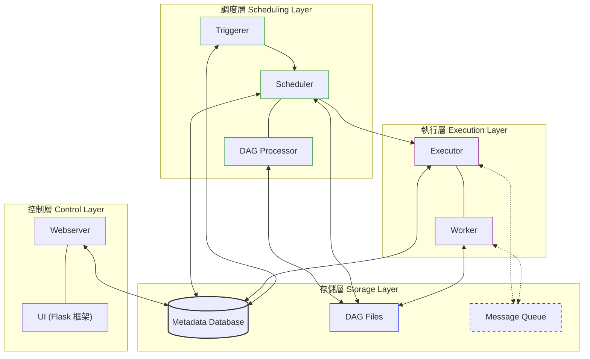

# DataFlow

A comprehensive data pipeline system built with Apache Airflow for collecting, processing, and analyzing financial data and news articles. This project automates the collection of stock information, news articles, and provides notification capabilities through various channels.

## Project Overview

DataFlow is designed to streamline the collection and processing of financial data and news articles. It leverages Apache Airflow's scheduling capabilities to automate various data collection tasks, including:

- Stock market data collection and analysis
- Chinese news article crawling from multiple sources
- PTT board and YouTube channel collection
- Notification delivery through Discord and Line
- Google Play game pre-registration and new releases collection (支援 Google Play、QooApp 多來源，自動去重)
- Rights-authorized Bahamut game guide collection
- Money101 credit-card data collection
- Approved official-source ingestion, market-signal analysis, and holdings-based notifications

## Technical Highlights

### Interesting Techniques

- **Web Scraping with BeautifulSoup**: Implements sophisticated [HTML parsing](https://developer.mozilla.org/en-US/docs/Web/API/Document_Object_Model/Introduction) techniques to extract structured data from news websites.
- **Asynchronous Task Scheduling**: Utilizes Airflow's [DAG (Directed Acyclic Graph)](https://airflow.apache.org/docs/apache-airflow/stable/concepts/dags.html) structure to manage complex task dependencies and scheduling.
- **Data Transformation Pipelines**: Converts raw scraped data into structured formats suitable for analysis and storage.
- **Containerization**: Uses Docker to ensure consistent deployment environments across different systems.
- **Regular Expression Processing**: Employs [regex patterns](https://developer.mozilla.org/en-US/docs/Web/JavaScript/Guide/Regular_Expressions) for text extraction and cleaning.
- **Error Handling and Notification**: Implements robust error handling with automated notifications when tasks fail.

### Notable Technologies

- **Apache Airflow**: Core orchestration engine for scheduling and monitoring workflows
- **TensorFlow/Keras**: Machine learning framework used for predictive models (referenced in stock utilities)
- **MySQL**: Primary database for storing collected data
- **SQLAlchemy**: ORM for database interactions
- **OpenCV**: Computer vision library used for image processing
- **Selenium**: Browser automation for websites that require JavaScript rendering
- **Discord Webhook Integration**: For sending notifications and alerts (`dags/lib/notify.py`)
- **Google Maps API**: For geolocation services

## Project Structure

```
.
├── dags/                   # Airflow DAG definitions
│   ├── common/             # Common utilities and configurations
│   ├── credit_cards/       # Credit card data collection
│   ├── game/               # Game releases, pre-registration, and guide ingestion
│   │   └── database/       # Game knowledge schema and read views
│   ├── lib/                # Core library functions
│   ├── news_ch/            # Chinese news collection
│   │   ├── utils.py        # Pure helpers (URL validation, text/time cleanup)
│   │   └── news_crawler/   # 一站一檔（anue.py, ettoday.py, ...），__init__.py 統一匯出
│   ├── ptt/                # PTT (Taiwanese forum) collection
│   ├── source_extension/   # Approved source registry, normalized records, and market signals
│   ├── stock/              # Stock data collection and analysis
│   │   └── error/          # Error handling for stock collection
│   └── youtube/            # YouTube data collection
├── plugins/                # Airflow plugins
│   ├── chromedriver-linux64/ # Chrome driver for Selenium
│   ├── figurine_notify/    # Figurine notification system
│   └── stock/              # Stock-related plugins
├── Dockerfile              # Docker configuration
├── docker-compose.yaml     # Docker Compose configuration
└── requirements.txt        # Python dependencies
```

### Key Directories

- **[dags/](./dags/)**: Contains all the Airflow DAG definitions that orchestrate the data collection and processing workflows.
- **[dags/lib/](./dags/lib/)**: Shared building blocks used across DAGs: `get_sql.py` (`get_sql_from_config` — the one place that reads `sql_config`), `db_upsert.py` (`replace_by_keys` delete-then-insert), `notify.py` (`discord_notifier(label, token_path=None)`), plus logging and calendar helpers. New DAGs should use these instead of re-reading the config files.
- **[dags/news_ch/](./dags/news_ch/)**: Modules for collecting news from various Chinese news sources.
- **[dags/stock/](./dags/stock/)**: Components for collecting and analyzing stock market data.
- **[plugins/](./plugins/)**: Custom Airflow plugins and external tools used by the system.

## Cursor Agent Skills

本儲存庫在 `.cursor/skills/` 提供專案層級 Cursor Skill（與 Airflow DAG 無關時可忽略）。

| Skill | 說明 |
|-------|------|
| `python-refactor` | Python 重構方法論：測試先行、可維護優先、避免過度封裝與假測試。主檔：`.cursor/skills/python-refactor/SKILL.md`。 |

## External Libraries and Resources

- [Apache Airflow](https://airflow.apache.org/)
- [TensorFlow](https://www.tensorflow.org/)
- [Keras](https://keras.io/)
- [BeautifulSoup](https://www.crummy.com/software/BeautifulSoup/)
- [SQLAlchemy](https://www.sqlalchemy.org/)
- [Selenium](https://www.selenium.dev/)
- [OpenCV](https://opencv.org/)
- [Discord Webhook API](https://discord.com/developers/docs/resources/webhook)
- [Google Maps API](https://developers.google.com/maps)

## System Requirements

- Docker and Docker Compose
- Python 3.12
- MySQL database
- Chrome browser (for Selenium-based crawling)

## DAG 執行日誌慣例

- 任務內 `print` 盡量帶 **`[模組或流程名]`** 前綴（例如 `[中文新聞]`、`[stock DAG]`），方便在 Airflow log 搜尋與對照任務。
- **失敗**時除訊息外會標出 **Python 例外類型**（如 `KeyError`、`ConnectionError`），便於區分是網頁改版、連線或資料問題。

## 股票資料回補 (Backfill)

當需要回補特定日期的股票資料時，修改 `dags/stock/config/config.py` 中的 `BACKFILL_DATE`：

```python
# 設定要回補的日期
BACKFILL_DATE = '2026-03-16'
```

**操作步驟：**
1. 設定 `BACKFILL_DATE` 為目標日期（格式 `YYYY-MM-DD`）
2. 在 Airflow UI 手動觸發股票收集 DAG
3. 等待 DAG 完成後，修改為下一個日期，再次觸發
4. 全部回補完成後，將 `BACKFILL_DATE` 改回空字串 `''` 恢復正常排程

**影響範圍：**
- `StockCollectLogic.now_time`：三大法人、個股成交等收集 API 的日期參數
- `is_taiwan_stock_close`：開盤日判斷
- `is_weekend`：週六才執行的任務（大戶比、融資券、月營收）

**注意事項：**
- 回補日若為假日，`is_taiwan_stock_close` 會跳過該日
- 依賴 `really_date`（從 DB 查最新三大法人日期）的任務，會在三大法人資料寫入後自動取得正確日期
- 回補完畢務必改回 `BACKFILL_DATE = ''`

## News crawler layout

Each Chinese-news source has its own module under `dags/news_ch/news_crawler/`; `__init__.py` exports the supported crawlers used by the collection DAGs.

## 重磅消息輿情快訊 (breaking_news)

`dags/breaking_news/` + `dags/breaking_news_alert.py`：每 5 分鐘掃描官方、通訊社與美國總統貼文，
達門檻立即推 Discord。推的是**市場風險事件**，不是選股名單，與 `market_signal_notify`、
`INTRADAY_PUSH_ENABLED` 完全獨立。

- 流程：`sources.py` 抓 RSS → `scoring.py` 標題評分（純函式）→ `policy.py` 決策 → `store.py` 寫帳本 → `pipeline.py` 推播。
- 來源：Fed 貨幣政策、川普 Truth Social（trumpstruth.org 存檔）、中央社財經、WSJ/CNBC/BBC/Al Jazeera、Google News（慢速、不算印證）。
- 評分：先要命中「觸發類別」（貨幣政策、貿易/制裁、戰爭、黑天鵝、能源、總經數據、關鍵人物異動、台海）才可能推；
  官方與總統貼文基礎分高，一般媒體要 ≥2 家不同媒體印證才升級 push。
- 防噪音：首次執行只記錄不推（seeded）、超過 90 分鐘的舊聞不推（stale）、同事件 12 小時內只推一次（duplicate，後來單則分數明顯更高才允許升級再推）、
  解說/直播/評論稿降分、Google News 只能當印證不單獨觸發推播、
  每小時 ≤3 則 / 每日 ≤10 則（score ≥8 且 ≥2 家不同媒體印證的極重大事件可繞過；單一來源連發不行）。
- 帳本 `breaking_news_events`（crawler DB）：**每一則**被評分的消息都記錄（含沒推的），
  `breaking_news_reaction_settle` 每日回填警示後的 TAIEX 日收盤反應（粗估，非盤中），用來長期檢驗門檻：看 push 的平均絕對報酬是否明顯高於同表輸出的「全部交易日基準線」，
  樣本不足時結論不可信。
- 頻道：預設 `新聞即時通`；要獨立頻道請先在 Discord token CSV 新增一列，再設環境變數 `BREAKING_NEWS_DISCORD_LABEL`。
- 調整：關鍵字與權重在 `scoring.py`，來源在 `sources.py`，上限在 `policy.py`。

## Database Maintenance

### 遊戲事前登陸資料表 (pre_registration)

#### 資料來源
- Google Play：使用固定 URL `promotion_3000000d51_pre_registration_games`（搜尋 API 為輔，無匹配時 fallback）
- QooApp：從 QooApp 新聞標籤頁面抓取事前登錄相關遊戲資訊（https://news.qoo-app.com/tag/%E4%BA%8B%E5%89%8D%E7%99%BB%E9%8C%84）

#### 去重機制
- 根據 `game_id` 去重（保留第一筆）
- 根據 `game_url` 去重（保留第一筆）
- 寫入資料庫前會先檢查現有資料，只寫入新的遊戲

### 遊戲新上架資料表 (new_releases)

#### 刪除重複資料

```sql
-- 方法1: 刪除重複的 game_id，保留 id 最小的記錄
DELETE t1 FROM new_releases t1
INNER JOIN new_releases t2 
WHERE t1.id > t2.id AND t1.game_id = t2.game_id;

-- 方法2: 刪除重複的 game_url，保留 id 最小的記錄
DELETE t1 FROM new_releases t1
INNER JOIN new_releases t2 
WHERE t1.id > t2.id AND t1.game_url = t2.game_url;

-- 方法3: 刪除同時重複 game_id 和 game_url 的記錄
DELETE t1 FROM new_releases t1
INNER JOIN new_releases t2 
WHERE t1.id > t2.id 
  AND t1.game_id = t2.game_id 
  AND t1.game_url = t2.game_url;
```

#### 設定主鍵 (Primary Key)

```sql
-- 檢查現有主鍵
SHOW KEYS FROM new_releases WHERE Key_name = 'PRIMARY';

-- 如果已有主鍵，先刪除
ALTER TABLE new_releases DROP PRIMARY KEY;

-- 設定 game_id 為主鍵（如果 game_id 唯一）
ALTER TABLE new_releases ADD PRIMARY KEY (game_id);

-- 或者設定複合主鍵（game_id + source）
ALTER TABLE new_releases ADD PRIMARY KEY (game_id, source);

-- 如果 id 欄位存在且需要保留為自增主鍵，可以設定 game_id 為唯一索引
ALTER TABLE new_releases ADD UNIQUE INDEX idx_game_id (game_id);
ALTER TABLE new_releases ADD UNIQUE INDEX idx_game_url (game_url);
```

#### 檢查重複資料

```sql
-- 檢查重複的 game_id
SELECT game_id, COUNT(*) as count 
FROM new_releases 
GROUP BY game_id 
HAVING COUNT(*) > 1;

-- 檢查重複的 game_url
SELECT game_url, COUNT(*) as count 
FROM new_releases 
GROUP BY game_url 
HAVING COUNT(*) > 1;
```


